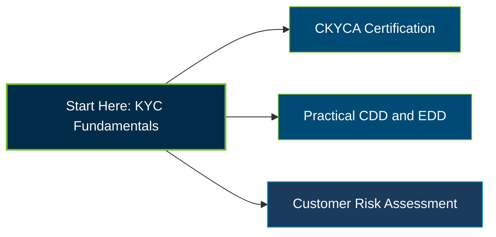

# ACAMS CKYCA Certification Exam Guide

A dedicated, comprehensive study guide and customer due diligence reference repository for candidates preparing for the **ACAMS Certified Know Your Customer Associate (CKYCA) Certification Exam**.

---

## Exam Overview

The ACAMS CKYCA Certification validates foundational skills in Know Your Customer (KYC), customer due diligence (CDD), enhanced due diligence (EDD), and risk-based customer assessment to help prevent financial crime.

- **Exam Format**: Multiple-choice certification exam delivered through Pearson VUE test centers or online proctoring.
- **Target Audience**: KYC Analysts, CDD Analysts, Client Onboarding Specialists, Compliance Analysts, and early-career Anti-Financial Crime Professionals.
- **Prerequisites**: No specific eligibility requirements for CKYCA; active ACAMS membership is required to obtain and maintain the certification.

---

## Core Exam Domains & Knowledge Areas

### 1. Identify and Verify the Customer

- Determine the customer type and gather information needed for customer identification and verification.
- Assess the nature and purpose of the account, including beneficial ownership and connected parties.
- Review customer information against account activity and available reliable sources.

### 2. Screen the Customer

- Screen customers against applicable sanctions lists and relevant risk information.
- Research adverse media and evaluate the reliability and relevance of sources.
- Validate screening results and distinguish material matches from false positives.

### 3. Rate the Customer's Risk

- Assess customer risk across customer, product, country, and delivery-channel categories.
- Recognize red flags involving money laundering, sanctions evasion, bribery, and tax evasion.
- Evaluate risk ratings against institutional risk assessments, risk appetite, and escalation requirements.

### 4. Perform Enhanced Due Diligence (EDD)

- Identify and assess source of wealth and other relevant risk information.
- Examine complex ownership structures and establish ultimate beneficial ownership.
- Review account activity and determine when further investigation or escalation is appropriate.

### 5. Create a Customer Profile

- Apply data privacy requirements and recognize the impact of inaccurate customer information.
- Prepare clear, objective customer profiles with appropriate supporting evidence.
- Maintain an audit trail and update customer records following periodic reviews or trigger events.

---

## Certification Path

The following is a suggested learning progression, not an official ACAMS prerequisite or successor-certification pathway.

---

## Recommended Practice & Study Resources

To prepare effectively, combine official ACAMS learning materials with supplementary practice and practical customer due diligence exercises.

- **CertsGate**: Explore [CKYCA certification preparation resources](https://certsgate.com/exams/acams/ckyca) for supplementary study materials and practice questions to reinforce KYC, CDD, EDD, and customer risk assessment concepts.
- **Practical Study Resource**: Review the [FATF Recommendations](https://www.fatf-gafi.org/en/publications/Fatfrecommendations/Fatf-recommendations.html) and apply a risk-based approach to customer identification, beneficial ownership, sanctions screening, and enhanced due diligence.
